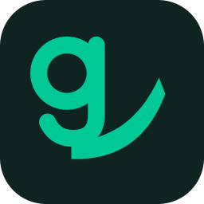

<div align="center">
  
  <h1>Getta: Setiap tautan, terkirim.</h1>
  <p><b>Tempel tautan. Getta menyimpan video, audio, gambar, atau file langsung ke foldermu.<br/>Gratis, open source, tanpa akun, tanpa terminal.</b></p>
  <a href="https://github.com/nekonaru/getta/releases/latest"></a>
  <a href="https://github.com/nekonaru/getta/actions/workflows/ci.yml"></a>
  
  
  <a href="https://github.com/nekonaru/getta/blob/main/LICENSE"></a>
</div>

<br />

[English](README.md) | **Bahasa Indonesia**

> [!NOTE]
> Getta masih rilis awal. Unduhan inti sudah jalan hari ini. Extractor native, torrent, kursus, dan Telegram ada di roadmap di bawah, belum ada di build ini.

---

## Daftar Isi

- [Tentang](#tentang)
- [Fitur](#fitur)
- [Kebutuhan](#kebutuhan)
- [Instalasi](#instalasi)
- [Penggunaan](#penggunaan)
- [Konfigurasi](#konfigurasi)
- [Struktur Proyek](#struktur-proyek)
- [Pengembangan](#pengembangan)
- [Pengujian](#pengujian)
- [Keamanan](#keamanan)
- [Continuous Integration](#continuous-integration)
- [Roadmap](#roadmap)
- [FAQ](#faq)
- [Penulis](#penulis)
- [Lisensi](#lisensi)

---

## Tentang

Getta adalah aplikasi gratis dan open source untuk mengambil media dan file dari seluruh web. Kamu tempel tautan, Getta menunjukkan apa yang ditemukannya, dan file langsung tersimpan di foldermu. Unduhan berjalan secara lokal lewat [yt-dlp](https://github.com/yt-dlp/yt-dlp) dan [FFmpeg](https://ffmpeg.org/). Tanpa akun, tanpa telemetri soal apa yang kamu unduh, tanpa terminal.

Getta adalah implementasi asli di bawah lisensi MIT.

---

## Fitur

### Ambil apa pun

| Fitur | Deskripsi |
|-------|-----------|
| **Omnibox** | Satu input untuk tautan tunggal, banyak tautan sekaligus, dan URL file langsung |
| **Deteksi platform** | Mengenali YouTube, Instagram, TikTok, X, Reddit, Twitch, Vimeo, Bilibili, SoundCloud, dan lainnya, plus halaman web umum dan file langsung |
| **Pratinjau media** | Judul, penulis, durasi, thumbnail, dan daftar kualitas sebelum mengunduh |
| **Pemilih daftar putar** | Playlist dianalisis dengan daftar ceklis; unduh semuanya atau hanya entri yang kamu mau |
| **Mode** | Video + audio, audio saja (m4a), atau video saja |
| **Banyak tautan** | Tempel banyak link sekaligus: Getta mengantrekan semuanya |
| **Pola nama file** | Template field yt-dlp dengan default yang aman, misalnya `%(title).200s [%(id)s].%(ext)s` |

### Antrean yang bisa diandalkan

| Fitur | Deskripsi |
|-------|-----------|
| **Jeda dan lanjut** | Jeda level proses di Windows, Linux, dan macOS; unduhan dilanjutkan dari posisi terakhir |
| **Coba ulang dengan backoff** | Coba ulang otomatis untuk rate limit dan error sementara dengan backoff eksponensial |
| **Konkurensi** | Jumlah unduhan bersamaan, jumlah koneksi per unduhan, dan jumlah coba ulang bisa diatur |
| **Batas kecepatan** | Batasi kecepatan unduh global (MB/s), bisa diubah dari layar Antrean |
| **Progres live** | Sparkline kecepatan, hitung mundur ETA, fase transfer, dan strip agregat di atas antrean |
| **Riwayat** | Unduhan selesai dengan ukuran, tombol unduh ulang, tampilkan, atau hapus |

### File kamu, satu tempat

| Fitur | Deskripsi |
|-------|-----------|
| **Pustaka** | Grid unduhan selesai kamu; putar video, audio, dan gambar langsung di aplikasi, filter per tipe |
| **Alat** | Meja kerja lokal: Video ke MP3, Video ke GIF, Kompres video (H.264), ditenagai FFmpeg |
| **Command palette** | Ctrl/Cmd+K launcher fuzzy: lompat ke halaman mana pun atau jalankan aksi seperti jeda semua dan lanjutkan semua |
| **Global hotkey** | Ctrl/Cmd+Shift+D mengambil dari clipboard dari mana pun |
| **Deep link** | `getta://<url>` membuka Getta dan mengantrekan tautannya |
| **Onboarding** | Wizard peluncuran pertama: bahasa, tema, pasang mesin, pilih folder tujuan |

### Nyaman dipakai

| Fitur | Deskripsi |
|-------|-----------|
| **UI dwibahasa** | Bahasa Inggris dan Bahasa Indonesia di semua layar |
| **Tema terang, gelap, dan sistem** | Mengikuti OS, bisa diubah di Pengaturan |
| **Desain editorial** | Kanvas bone hangat, aksen cobalt, daftar antrean bergaya manifest, sidebar bernomor |
| **System tray** | Klik kiri membuka/menyembunyikan window; klik kanan menu Tampilkan / Keluar dalam bahasa kamu |
| **Autostart** | Opsi menjalankan Getta saat sistem menyala di Pengaturan |
| **Tanpa akun, tanpa telemetri** | Getta tidak mengumpulkan apa pun soal apa yang kamu unduh |
| **Mesin yang memasang dirinya** | Pemasangan yt-dlp dan FFmpeg terverifikasi dengan pengecekan SHA-256 |

---

## Kebutuhan

### Untuk memakai Getta

| Ketergantungan | Versi minimum | Catatan |
|----------------|---------------|---------|
| **Windows** | 10 (x64) | WebView2, sudah terpasang di Windows 11 |
| **macOS** | 12 (Monterey) | Apple Silicon dan Intel |
| **Linux** | Ubuntu 22.04+ / Fedora 37+ | WebKitGTK 4.1 (`libwebkit2gtk-4.1-0`) |

> [!TIP]
> Tidak perlu alat build untuk installer. Pengguna Linux di distro lama bisa coba AppImage sebagai pengganti deb atau rpm.

### Untuk membangun dari source

| Ketergantungan | Versi minimum | Catatan |
|----------------|---------------|---------|
| **Node.js** | 22 LTS atau lebih baru | npm sudah termasuk |
| **Rust** | stable (via rustup) | MSVC di Windows, toolchain sistem di macOS/Linux |
| **Header Linux** | Ubuntu 22.04+ | `libwebkit2gtk-4.1-dev libayatana-appindicator3-dev librsvg2-dev libsoup-3.0-dev` |

### Belum pernah pakai terminal? Mulai dari sini

<details><summary><b>Membuka terminal di sistemmu</b></summary>

1. **Windows.** Tekan `Win + R`, ketik `cmd`, tekan Enter. Atau cari "Terminal" di menu Start.
2. **macOS.** Tekan `Cmd + Spasi`, ketik "Terminal", tekan Enter.
3. **Linux.** Tekan `Ctrl + Alt + T`, atau cari "Terminal" di aplikasi.

</details>

---

## Instalasi

### Opsi A: Download (paling mudah)

1. Buka [halaman Releases](https://github.com/nekonaru/getta/releases/latest).
2. Download file untuk sistemmu:
   - **Windows.** `getta_x.y.z_x64-setup.exe` (installer) atau `.msi` untuk deployment IT.
   - **macOS.** `getta_x.y.z_aarch64.dmg` (Apple Silicon) atau `getta_x.y.z_x64.dmg` (Intel).
   - **Linux.** `.deb` (Debian/Ubuntu), `.rpm` (Fedora/openSUSE), atau `.AppImage` (lainnya).
3. Buka file dan ikuti petunjuknya.

> [!IMPORTANT]
> Getta tidak ditandatangani dengan sertifikat berbayar. Di Windows, SmartScreen memunculkan peringatan: klik **More info**, lalu **Run anyway**. Di macOS, jika Gatekeeper bilang aplikasinya rusak, jalankan `xattr -dr com.apple.quarantine /Applications/Getta.app` sekali setelah aplikasi dipindahkan ke Applications.

### Opsi B: Build dari source (untuk pengembangan / membaca atau mengubah kode)

#### 1. Ambil kodenya

<details><summary><b>Saya sudah punya Git</b></summary>

```bash
git clone https://github.com/nekonaru/getta.git
cd getta
```

</details>

<details><summary><b>Saya belum punya Git</b></summary>

1. Klik **Code** di halaman repository, lalu **Download ZIP**.
2. Ekstrak dan buka terminal di folder hasil ekstrak.

</details>

#### 2. Pasang dependensi dan verifikasi

```bash
npm ci
npm run check
npm test
```

#### 3. Build atau jalankan

```bash
npx tauri dev      # jalankan aplikasi mode pengembangan (compile Rust dulu)
npx tauri build    # buat installer di src-tauri/target/release/bundle
```

---

## Penggunaan

### Peluncuran pertama

1. Buka Getta. Layar beranda menampilkan kolom untuk satu URL; banner di atas memberitahu jika mesin unduhan belum terpasang, dengan tombol untuk memasangnya.
2. Tempel tautan (coba video publik). Getta membacanya dan menampilkan pratinjau.
3. Pilih kualitas dan mode, lalu tekan **Unduh**.
4. Pantau di tab Antrean.

> [!NOTE]
> Di peluncuran pertama, Getta bisa menanyakan lokasi penyimpanan file. Default adalah folder Downloads; ubah di Pengaturan, Simpan ke.

### Pemakaian sehari-hari

- **Tempel banyak tautan sekaligus.** Getta mendeteksinya dan mengantrekan semuanya.
- **Audio saja.** Ganti mode ke "Audio saja" sebelum mengunduh.
- **Jeda.** Gunakan tombol jeda pada item; lanjutkan saat kamu mau. Di Windows, jeda level proses menjaga file parsial tetap konsisten.
- **Batasi kecepatan.** Gunakan pilihan batas kecepatan di layar Antrean, atau pengaturan di Pengaturan, Transfer.
- **Situs yang butuh login.** Di Pengaturan, Mesin, isi browser yang dibaca cookie-nya oleh Getta (misalnya `chrome`, `firefox`).
- **Bersihkan antrean.** "Bersihkan yang selesai" menghapus item selesai dan gagal dari daftar.

---

## Konfigurasi

Getta menyimpan datanya di satu folder:

| Platform | Lokasi |
|----------|--------|
| Windows | `%APPDATA%\getta` |
| macOS | `~/Library/Application Support/getta` |
| Linux | `~/.local/share/getta` |

Di dalamnya: `settings.json` (tulis atomik), `history.json` (200 entri terakhir), `bin/` (yt-dlp dan FFmpeg terkelola). Set `GETTA_DATA_DIR` untuk mengganti lokasinya.

Pengaturan ada di dalam aplikasi: folder output dan pola nama file, konkurensi, batas kecepatan, path mesin, cookies, dan proxy.

---

## Struktur Proyek

```
getta/
├── src/                    # Frontend SvelteKit (Svelte 5)
│   ├── routes/             # Beranda, Antrean, Pustaka, Alat, Pengaturan
│   ├── lib/                # Jembatan API, stores, i18n (en/id), format
│   └── app.css             # token desain dan gaya dasar
├── src-tauri/              # Backend Rust (Tauri 2)
│   ├── src/                # antrean, manajemen yt-dlp, pengaturan, riwayat
│   ├── icons/              # ikon aplikasi (semua target)
│   └── tauri.conf.json
├── static/                 # favicon dan web manifest
├── assets/logo/            # file sumber logo Getta
├── README.md               # dokumentasi bahasa Inggris
└── README.id.md            # terjemahan bahasa Indonesia
```

---

## Pengembangan

### Menambahkan string untuk pengguna

1. Tambahkan key ke `src/lib/i18n/en.json` dan `src/lib/i18n/id.json` di commit yang sama.
2. Pakai `t("section.key")` di komponen. Bahasa Inggris adalah sumber; Bahasa Indonesia mencerminkannya.

### Merilis

1. Naikkan `version` di `package.json`, `src-tauri/Cargo.toml`, dan `src-tauri/tauri.conf.json` di commit yang sama.
2. Perbarui `CHANGELOG.md` dan `CHANGELOG.id.md`.
3. Push tag `vX.Y.Z`. CI membangun dan melampirkan installer ke release GitHub.

---

## Pengujian

```bash
npm test
```

| Pengecekan | Syarat |
|------------|--------|
| `npm run check` | Nol error, nol warning (svelte-check, fail-on-warnings) |
| `npm test` | Unit test lolos (vitest) |
| `cargo test --manifest-path src-tauri/Cargo.toml` | Unit test Rust lolos (di CI; butuh C toolchain di lokal) |
| `npm run build` | Build produksi Vite berhasil |

---

## Keamanan

Getta mengunduh mesin unduhannya dari penerbit resminya dan memverifikasi SHA-256 yt-dlp terhadap file sums upstream sebelum memasang; pemasangan ditolak ketika verifikasi gagal. Pengaturan dan riwayat ditulis secara atomik, dan file korup dikarantina lalu di-reset, bukan dihapus membabi buta. Tidak ada telemetri dan tidak ada akun; satu-satunya panggilan jaringan menuju situs yang kamu unduh dan penerbit mesin saat kamu memasang atau memperbarui. Lihat [`SECURITY.md`](SECURITY.md) untuk cara melaporkan celah keamanan.

---

## Continuous Integration

| Workflow | Tujuan |
|----------|--------|
| `ci.yml` | Check, test, dan build frontend; `cargo check` dan `cargo test` di Linux, Windows, dan macOS |
| `release.yml` | Pada tag `v*`: membangun installer untuk Linux, Windows, dan macOS dan menerbitkannya ke release GitHub |

---

## Roadmap

Direncanakan, belum dirilis: extractor native untuk platform-platform besar (lebih cepat, paham cookies), dukungan bittorrent, pengunduh kursus, integrasi Telegram, mode command-line. Tidak ada yang dijamin sebelum tag rilis terbit.

---

## FAQ

<details><summary><b>Apakah Getta butuh Python?</b></summary>

Tidak. Getta mengunduh dan menjalankan binary resmi yt-dlp. Python tidak terlibat.

</details>

<details><summary><b>Bisakah Getta mengunduh video yang diproteksi DRM?</b></summary>

Tidak. Getta tidak membobol DRM, paywall, atau kontrol akses.

</details>

<details><summary><b>File tersimpan di mana?</b></summary>

Defaultnya folder Downloads, atau apa pun yang kamu pilih di Pengaturan. Dengan "Buat folder per situs" aktif, file tersimpan di subfolder per platform.

</details>

<details><summary><b>Kenapa Windows memperingatkan tentang installer?</b></summary>

Getta open source dan tidak ditandatangani dengan sertifikat berbayar. Itu hal normal untuk aplikasi desktop gratis. Lihat bagian Instalasi untuk cara melanjutkannya.

</details>

<details><summary><b>Apakah Getta bisa dipakai di HP?</b></summary>

Tidak. Getta adalah aplikasi desktop (Windows, macOS, Linux). Belum ada build mobile dan belum direncanakan.

</details>

---

## Penulis

<div align="center">

| |
|:-:|
| [](https://github.com/nekonaru) |
| **[Nicolas Dwi Dharma](https://github.com/nekonaru)** |

</div>

---

## Lisensi

Didistribusikan di bawah **MIT License**. Lihat [`LICENSE`](LICENSE) untuk informasi lebih lanjut.


